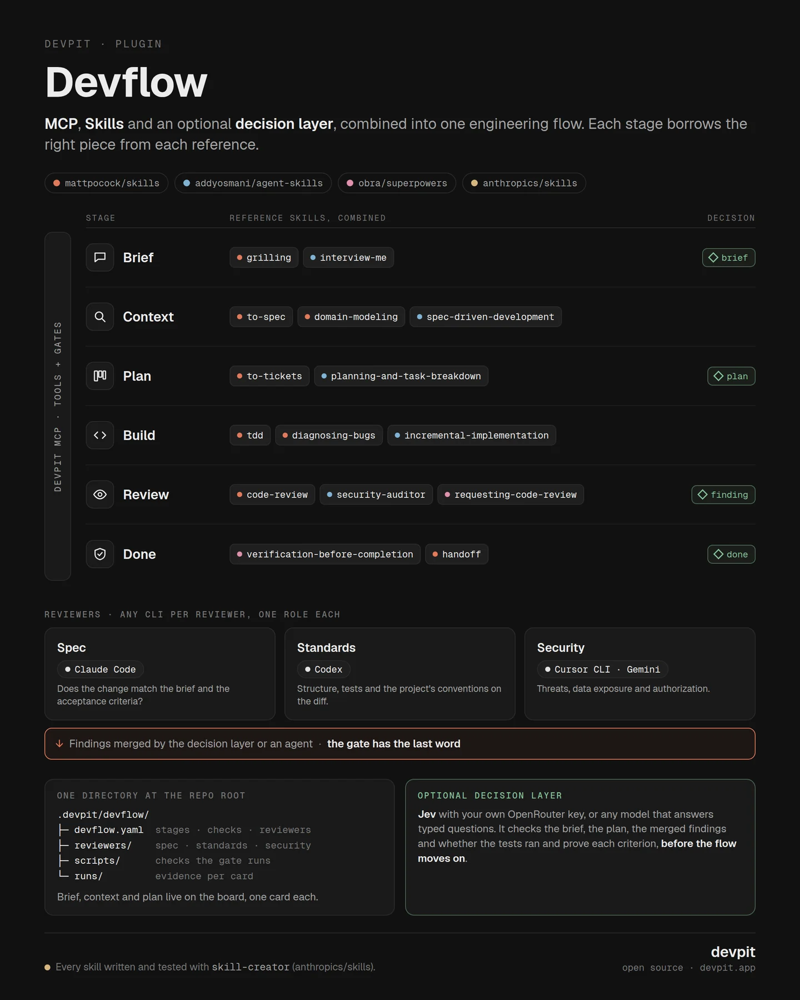

In the [Orchestrator post](/blog/devpit-orchestrator-sessions-workflow) I said I was preparing the next update. A good part of it is **Devflow**, a devpit plugin that takes a piece of work from the brief to the done card. This post is about how it came together.



## It Started With Skills

For a while I used skills from several repositories at the same time. Each one is good at something, and none of them covers the whole path. So I did what I do with any good reference: I took the right piece from each one and used it in isolation, at the stage where it makes sense.

- **brief:** `grilling` + `interview-me`;
- **context:** `to-spec` + `domain-modeling` + `spec-driven-development`;
- **plan:** `to-tickets` + `planning-and-task-breakdown`;
- **build:** `tdd` + `diagnosing-bugs` + `incremental-implementation`;
- **review:** `code-review` + `security-auditor` + `requesting-code-review`;
- **done:** `verification-before-completion` + `handoff`.

The references:

- [mattpocock/skills](https://github.com/mattpocock/skills) (MIT), by Matt Pocock;
- [addyosmani/agent-skills](https://github.com/addyosmani/agent-skills) (MIT), by Addy Osmani;
- [obra/superpowers](https://github.com/obra/superpowers) (MIT), by Jesse Vincent;
- [anthropics/skills](https://github.com/anthropics/skills) (Apache-2.0), whose `skill-creator` I used to write and test each Devflow skill, with its own evals.

The Devflow skills are devpit's own text, written for its tools and its board. What they take from these repositories is the method.

## The Flow Needed Structure

Putting the skills together, I realized the problem wasn't a lack of instructions. A skill says what to do, but it doesn't keep what was decided, doesn't run the tests on its own and doesn't stop the work when something is missing. For that the flow needed a place to live.

That place is a folder at the repository root:

```
.devpit/devflow/
├── devflow.yaml   stages, checks, reviewers, decisions
├── reviewers/     the review personas
├── scripts/       the checks the gate runs
└── runs/          the evidence of each card
```

The brief, the context and the plan stay on the board, tied to the cards: the brief becomes an epic, the context is written onto it, and the plan becomes child cards, each with its acceptance criteria and the command that proves them. What sits in the folder is the project's way of working; what sits on the board is the work.

devpit serves all of this through its MCP, with **one tool per stage** and **gates** between them. The brief and the plan wait for my explicit yes. The build runs the checks and keeps reports, screenshots and video as evidence on the card. And a card is only called done when the gate passes: the newest evidence came after the last change, each criterion maps to passing tests and the review left nothing blocking.

## Reviews I Can Combine

This is the part I use most. I like to combine different review criteria, because each reviewer looks at one thing and misses others.

With Devflow I can add more than one reviewer and pick a different application for each one: Claude Code, Codex, Cursor CLI or Gemini, with the model I want. Each reviewer has its own responsibility, written as a persona:

```yaml
review:
  reviewers:
    - agent: claude
      persona: devflow-spec       # does the change match the brief and the criteria?
    - agent: codex
      persona: devflow-standards  # the repository's own rules
    - agent: gemini
      persona: devflow-security   # STRIDE, OWASP, a proof per finding
  block_on: [critical, high]
  consolidate: jev
```

devpit ships those three personas, and I can write my own: in the project, in a team layer or in my home folder, so one way of reviewing follows me into every project.

The stages run in sequence. Inside the review, every reviewer gets the same packet (the diff, the card, its criteria) and works on it on its own. Then the findings become one list, and the gate has the last word: if something at a blocking severity is left, the card goes back to the build.

## An Optional Decision Layer

The last piece is optional. With my own OpenRouter key, devpit can call **Jev**, a decision model that answers typed questions with a probability for each answer. Any decision model that works with a similar structure fits there.

It enters at a few points of the flow, each with its own rubric:

- **brief:** does it state the goal, what is out of scope and a success that can be checked?
- **plan:** is every card a vertical slice, with criteria a test can check and the right dependencies?
- **review:** which findings are real and which ones are the same?
- **done:** is every criterion met, did the tests and checks run and pass, and did the change stay in scope?

It helps to validate each stage before moving on, including the generated tests: whether they ran, passed and show each criterion met. Jev receives the brief, the plan, the criteria with their evidence and the findings, never the diff.

It can run in **shadow**, where it only records what it would have decided, or in **enforce**, where it holds the stage. And it's optional: without a key, the flow works the same way, and the gate is the checks'.

## Where It Is

I've been using Devflow on real projects these last few days, and what it gives me most is the review: bugs found before production, with the test written first. There's still a lot to adjust, and I'm writing down what comes up along the way.

devpit is open source. If you want to try it:

```sh
curl -fsSL https://devpit.app/install.sh | sh
```

---

**Links:**

- [devpit on GitHub](https://github.com/jholhewres/devpit)
- [Site and documentation](https://devpit.app)
- [Post: One Orchestrator for Every Project](/blog/devpit-orchestrator-sessions-workflow)
- [Post: devpit — One Workspace Per Project](/blog/devpit-agentic-development-environment)
