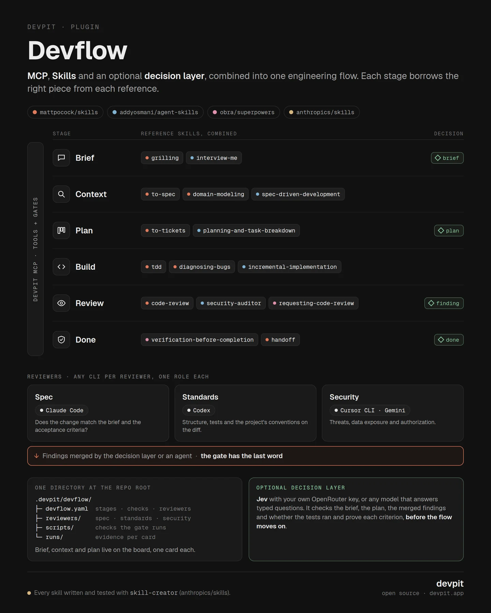

No [post do Orquestrador](/blog/devpit-orchestrator-sessions-workflow) eu disse que estava preparando a próxima atualização. Boa parte dela é o **Devflow**, um plugin do devpit que leva um trabalho do briefing até o card concluído. Este post é sobre como ele foi montado.



## Começou Pelas Skills

Por um tempo eu usei skills de vários repositórios ao mesmo tempo. Cada um é bom em alguma coisa, e nenhum cobre o caminho inteiro. Então fiz o que faço com qualquer boa referência: peguei o trecho certo de cada um e usei de forma isolada, na etapa em que ele faz sentido.

- **brief:** `grilling` + `interview-me`;
- **context:** `to-spec` + `domain-modeling` + `spec-driven-development`;
- **plan:** `to-tickets` + `planning-and-task-breakdown`;
- **build:** `tdd` + `diagnosing-bugs` + `incremental-implementation`;
- **review:** `code-review` + `security-auditor` + `requesting-code-review`;
- **done:** `verification-before-completion` + `handoff`.

As referências:

- [mattpocock/skills](https://github.com/mattpocock/skills) (MIT), do Matt Pocock;
- [addyosmani/agent-skills](https://github.com/addyosmani/agent-skills) (MIT), do Addy Osmani;
- [obra/superpowers](https://github.com/obra/superpowers) (MIT), do Jesse Vincent;
- [anthropics/skills](https://github.com/anthropics/skills) (Apache-2.0), de onde vem o `skill-creator`, que eu usei pra escrever e testar cada skill do Devflow, com os seus próprios evals.

As skills do Devflow são texto do próprio devpit, escritas pras ferramentas e pro quadro dele. O que elas tiram desses repositórios é o método.

## O Fluxo Pedia Estrutura

Juntando as skills, eu percebi que o problema não era falta de instrução. Uma skill diz o que fazer, mas não guarda o que foi decidido, não roda os testes sozinha e não segura o trabalho quando falta alguma coisa. Pra isso o fluxo precisava de um lugar pra morar.

Esse lugar é um diretório na raiz do repositório:

```
.devpit/devflow/
├── devflow.yaml   etapas, checks, revisores, decisões
├── reviewers/     as personas de revisão
├── scripts/       os checks que o gate roda
└── runs/          as evidências de cada card
```

O briefing, o contexto e o plano ficam no quadro, ligados aos cards: o briefing vira um épico, o contexto é escrito nele, e o plano vira cards filhos, cada um com os seus critérios de aceite e o comando que os prova. O que fica no diretório é o jeito de trabalhar do projeto; o que fica no quadro é o trabalho.

O devpit serve tudo isso pelo MCP dele, com **uma tool por etapa** e **gates** entre elas. O briefing e o plano esperam o meu sim explícito. O build roda os checks e guarda relatórios, screenshots e vídeo como evidência no card. E um card só é dado como concluído quando o gate passa: a evidência mais nova veio depois da última mudança, cada critério tem testes passando e a revisão não deixou nada bloqueante.

## Revisões Que Eu Posso Combinar

Essa é a parte que eu mais uso. Eu gosto de combinar critérios de revisão diferentes, porque cada revisor olha uma coisa e deixa passar outras.

Com o Devflow eu consigo adicionar mais de um revisor e escolher uma aplicação diferente pra cada um: Claude Code, Codex, Cursor CLI ou Gemini, com o modelo que eu quiser. Cada revisor tem a sua responsabilidade, escrita como uma persona:

```yaml
review:
  reviewers:
    - agent: claude
      persona: devflow-spec       # a mudança atende o briefing e os critérios?
    - agent: codex
      persona: devflow-standards  # as regras do próprio repositório
    - agent: gemini
      persona: devflow-security   # STRIDE, OWASP, uma prova por achado
  block_on: [critical, high]
  consolidate: jev
```

O devpit vem com essas três personas, e eu posso escrever as minhas: no projeto, numa camada do time ou na minha pasta pessoal, então um jeito de revisar me acompanha em todos os projetos.

As etapas rodam em sequência. Dentro da revisão, todos os revisores recebem o mesmo pacote (o diff, o card, os critérios) e trabalham nele cada um por conta própria. Depois os achados viram uma lista só, e o gate dá a última palavra: se sobrou algo numa severidade que bloqueia, o card volta pro build.

## Uma Camada Opcional de Decisão

A última peça é opcional. Com a minha própria chave da OpenRouter, o devpit consegue chamar o **Jev**, um modelo de decisão que responde perguntas tipadas com uma probabilidade pra cada resposta. Qualquer modelo de decisão que trabalhe numa estrutura parecida cabe ali.

Ele entra em alguns pontos do fluxo, cada um com a sua rubrica:

- **brief:** diz o objetivo, o que fica de fora e um sucesso que dá pra conferir?
- **plan:** cada card é uma fatia vertical, com critérios que um teste consegue checar e as dependências certas?
- **review:** quais achados são reais e quais são o mesmo?
- **done:** cada critério foi atendido, os testes e checks rodaram e passaram, e a mudança ficou no escopo?

Ele ajuda a validar cada etapa antes de seguir, inclusive os testes gerados: se rodaram, se passaram e se mostram cada critério atendido. O Jev recebe o briefing, o plano, os critérios com as evidências e os achados, nunca o diff.

Dá pra rodar em **shadow**, em que ele só registra o que teria decidido, ou em **enforce**, em que ele segura a etapa. E é opcional: sem chave, o fluxo funciona do mesmo jeito, e o gate fica com os checks.

## Onde Ele Está

Venho usando o Devflow em projetos reais nos últimos dias, e o que ele mais me dá é a revisão: bugs encontrados antes de produção, com o teste escrito primeiro. Ainda tem bastante coisa pra ajustar, e eu vou anotando o que aparece no caminho.

O devpit é open source. Se você quiser testar:

```sh
curl -fsSL https://devpit.app/install.sh | sh
```

---

**Links:**

- [devpit no GitHub](https://github.com/jholhewres/devpit)
- [Site e documentação](https://devpit.app)
- [Post: Um Orquestrador Pra Todos os Projetos](/blog/devpit-orchestrator-sessions-workflow)
- [Post: devpit — Um Espaço de Trabalho Por Projeto](/blog/devpit-agentic-development-environment)
