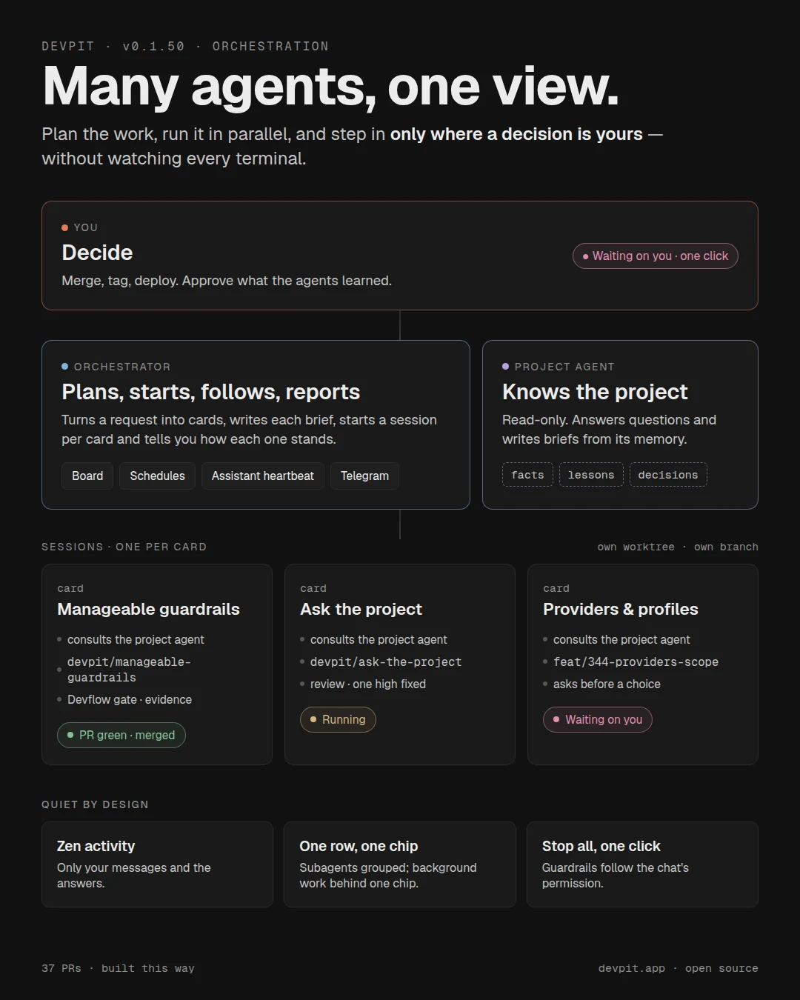

In the [Orchestrator post](/blog/devpit-orchestrator-sessions-workflow) I talked about how I start sessions across several projects from a single chat. In the [Devflow one](/blog/devpit-devflow), how a card goes from the brief to the gate. devpit v0.1.50 is where I really put the two together: 37 PRs, almost all of them coming out of a card with its own session, running in parallel.

I don't want this post to turn into a changelog. I want to tell how I run several agents at the same time without getting lost, and the release itself is the best example I have.



## The Problem Stopped Being the Code

When I have several fronts open, each one has its own terminal, its own agent and its own context. The code itself moves along fine. What starts to get stuck is me, trying to remember where each front stopped, what finished, what broke and what is waiting for an answer from me.

So my question changed. I stopped thinking about how to go faster and started thinking about how to follow the whole process without losing track. I still read everything, but now I can follow each front in detail, from the brief to the delivery, knowing which step it's on. What I have for that today comes down to four things: plan well, run in parallel, keep the screen organized and decide where I'm needed.

## First I Plan

Everything starts in the Orchestrator chat. I explain what I want, the way it comes to mind, and the request becomes cards on the project's board. Each card needs a brief saying what to do, where to change things and which rules to follow. That brief is now written by the project agent, which I explain just below.

## An Agent That Knows the Project

There are plenty of tools that create several agents: one to review code, another to plan, another to execute. I've used a lot of them. But after centralizing my work in the Orchestrator, I realized that what made the most difference was having one agent that knows the project, and that uses skills and tools to do each of those things.

That's where the prototype of the Project Agent came from, and it went into Labs in this version. And there's a distinction worth making here: I'm not talking about a session that carries context and memory while it works. It's an actual agent, one per project, that embodies the project's instructions the same way a `CLAUDE.md` does: what it has to follow, how things are done there, what went wrong before and what was decided.

And it keeps evolving. Every time a card closes, it proposes the lessons it took from that work. When a file it relied on changes, it reviews what it knew. None of it goes in on its own: I approve, edit or discard each proposal.

```
.devpit/project-agent/
├── facts.md       what is true of the project
├── lessons.md     what went wrong before and how to avoid it
└── decisions.md   what was decided and why
```

Combined with the Orchestrator, this makes the whole team better. The Orchestrator asks it instead of reading the project from scratch, and it's the one that writes each card's brief. The sessions check with the agent before going off exploring, and what they learn goes back to it as a proposal. I also talk to it directly, through "Ask the project" in the sidebar, and the answers say which files they rest on.

It only reads: it doesn't edit, commit or push. It wakes up when someone calls it, goes to sleep after ten idle minutes and, when it comes back, picks up the same conversation with its memory up to date.

It's still being tested. I'm validating the concept in this version, in my day-to-day work, and I hope it holds up. If it works out, the idea is for each project to have its own agent growing along with it.

## Then I Set It Running, Three at a Time

Each card gets its own session, in a worktree of its own. In this version the branch also got a name you can actually read, like `fix/351-flaky-tests`, and the pattern can be changed in the settings.

I gave myself a rule: at most three sessions in progress at the same time, and a new one only starts when another finishes. It isn't a devpit limit or a machine limit, it's how much fits in my attention. With three, I still know off the top of my head what each one is doing.

Each session can ask the project agent up to ten questions, and the brief asks it to check before picking a pattern the memory already settled.

What I like most is that this closes a loop. The lessons the agent proposes at the end of each card come from the card's comments and what the review found, and the ones I approve go into the next briefs and into that project's Devflow reviews.

After the merge, devpit cleans up the card's worktree, build cache and local branch on its own. If there's anything uncommitted, it leaves it alone and shows it to me. With several fronts going through there, that saves a lot of leftover mess.

## The Screen Got Quieter

Three sessions and an Orchestrator talk a lot. I read all of it, but I don't need all of it open on screen at the same time. In this version I got to choose how much I see in the chat at each moment.

The Activity menu shows everything, hides what succeeded, hides it all or keeps only my messages and the answers, which is Zen mode. Subagents that start together become a single row, and whatever keeps running in the background goes into a chip next to the message box, with a Stop for each task.

In the sidebar, each conversation shows which agent is running and whether it's working, waiting on me or already finished, split into In progress and Settled. I can look at the list and know where everything stands without opening anything.

What needs me sits in one place, "Waiting on you", next to the Orchestrator chat. That's where the questions the sessions stopped on show up, and I answer with one click. The click only counts if the session is still showing that same question, so I don't risk answering something that already moved on.

Stopping sessions got lighter too. If I ask the Orchestrator to stop a few and what I wrote doesn't cover all of it, the requests wait above the message box, each one saying what it would lose, and one click on "Stop all" stops them all. Drafted replies work the same way, with "Send all".

## I'm Still the One Who Decides

Having less on screen can't turn into deciding less, so I keep a few fixed rules for that.

The Orchestrator's guardrails can now be adjusted in Settings. For each confirmation (stopping a session, forcing a stop that loses work or sending a draft in my name) I choose whether it follows the chat's permission, always asks or never asks. Following the permission, in Full access it doesn't keep asking me to confirm twice. The exception is losing work, which by default asks even in Full access.

And merge, tag and deploy go through me. In v0.1.50 the sessions worked in parallel the whole time, but what went out into the world had my ok.

## Deliveries Got More Complete

This is the part I feel the most day to day. Over the last three weeks, with Devflow in the process together with orchestration, I've had almost no rework and almost no feature left incomplete because some detail was missing.

A good part of that comes from the start. The briefing and the planning are much better: the brief already arrives with the project's context, its rules and the lessons from earlier cards, and each card has clear acceptance criteria.

The other part comes from the end. A card is only called done when the Devflow gate passes, with evidence newer than the last change, a passing test for each criterion and nothing blocking in the final review. Only then does it become a PR.

With the start and the end tied up like that, the delivery comes out 100%, and what reaches me for approval is already complete.

## When I'm Not Looking

The last part is for when I step away from the computer. The Orchestrator got an Assistant mode, which is just a toggle in the corner of the chat and comes off by default.

With it on, I have a Schedules list in the sidebar, with reminders and routines together: a morning summary, CI failures, PRs waiting and cards waiting for review. I'm the one who schedules. The Orchestrator can suggest, but the suggestion waits for me to accept it.

There's also a heartbeat, which every so often checks for CI failing on an open PR, a session stuck on a question for too long or a blocked card. If there's nothing new, it stays quiet. If there is, it says so once and that's it. And it never starts any work on its own.

When I come back after half an hour away, the Orchestrator sums up in three lines what ran, what got merged and what is waiting for a decision. And Telegram works both ways: a session's question arrives with buttons, a draft arrives with a send button, and anything else I write there reaches the Orchestrator as if I had typed it in the chat.

## What Comes Next

There's still plenty in the queue. Remote and voice are the next fronts, and the project agent is still in Labs, so it can be turned on and off.

The way of working I don't plan to change. Plan in cards, run in parallel as much as fits in my attention, follow each step closely and decide when it's on me.

devpit is open source. If you want to try it:

```sh
curl -fsSL https://devpit.app/install.sh | sh
```

---

**Links:**

- [Release v0.1.50](https://github.com/jholhewres/devpit/releases/tag/v0.1.50)
- [Docs: the project agent](https://devpit.app/docs/project-agent)
- [Docs: Assistant mode](https://devpit.app/docs/assistant)
- [Docs: guardrails](https://devpit.app/docs/guardrails)
- [devpit on GitHub](https://github.com/jholhewres/devpit)
- [Post: Devflow, From Agent Skills to a Development Flow](/blog/devpit-devflow)
- [Post: One Orchestrator for Every Project](/blog/devpit-orchestrator-sessions-workflow)
