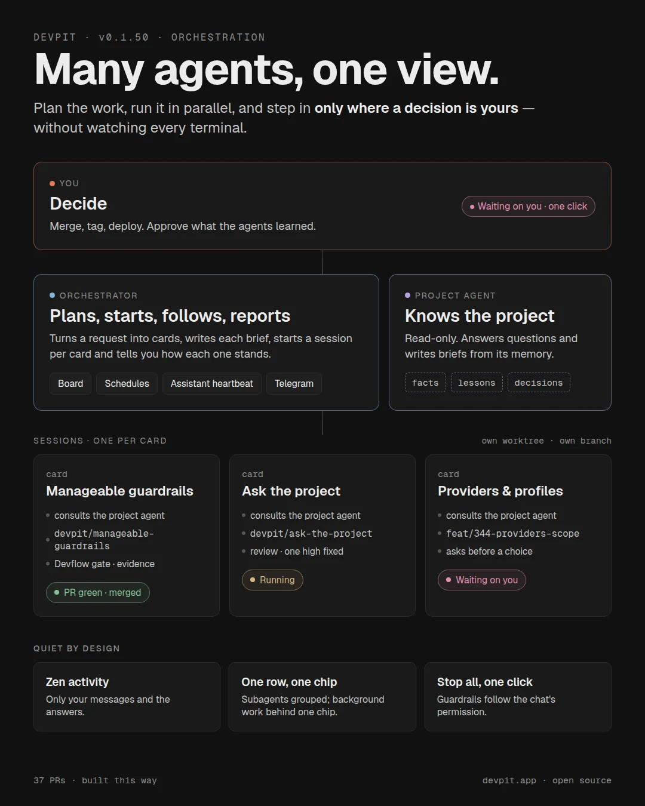

No [post do Orquestrador](/blog/devpit-orchestrator-sessions-workflow) eu contei como abro sessões em vários projetos a partir de um chat só. No [do Devflow](/blog/devpit-devflow), como um card vai do briefing até o gate. A v0.1.50 do devpit foi onde eu juntei as duas coisas de verdade: foram 37 PRs, quase todos saídos de um card com a sua própria sessão, rodando em paralelo.

Não quero que este post vire um changelog. Quero contar como eu conduzo vários agentes ao mesmo tempo sem me perder, e a própria release é o melhor exemplo que eu tenho.



## O Problema Deixou de Ser o Código

Quando eu tenho várias frentes abertas, cada uma tem o seu terminal, o seu agente e o seu contexto. O código em si anda bem. Quem começa a travar sou eu, tentando lembrar onde cada frente parou, o que terminou, o que quebrou e o que está esperando uma resposta minha.

Então a minha pergunta mudou. Eu parei de pensar em como fazer mais rápido e passei a pensar em como acompanhar o processo inteiro sem me perder. Eu continuo lendo tudo, mas agora consigo seguir cada frente em detalhe, do brief até a entrega, sabendo em que etapa ela está. O que eu tenho hoje pra isso passa por quatro coisas: planejar bem, rodar em paralelo, deixar a tela organizada e decidir onde precisa de mim.

## Primeiro Eu Planejo

Tudo começa no chat do Orquestrador. Eu explico o que quero, do jeito que vem na cabeça, e o pedido vira cards no board do projeto. Cada card precisa de um brief dizendo o que fazer, onde mexer e quais regras seguir.

Antes, o Orquestrador lia o projeto pra escrever cada um desses briefs. Agora cada projeto tem o seu próprio agente. Ele é uma sessão do Claude Code que só lê, sem poder editar, commitar ou dar push, e que guarda uma memória do projeto com data e fonte em cada entrada:

```
.devpit/project-agent/
├── facts.md       o que é verdade no projeto
├── lessons.md     o que já deu errado e como evitar
└── decisions.md   o que foi decidido e por quê
```

O Orquestrador pergunta pra ele sobre o projeto e pede que ele escreva o brief de cada card. Ele acorda quando alguém chama, dorme depois de dez minutos parado e, quando volta, continua a mesma conversa.

Eu também converso com ele direto, pelo "Ask the project" na sidebar. As respostas dizem em quais arquivos se apoiam, e nada vira fato na memória sem eu aprovar.

## Depois Eu Ponho Pra Rodar, Três de Cada Vez

Cada card ganha a sua sessão, numa worktree só dela. Nesta versão a branch também passou a ter um nome que dá pra ler, tipo `fix/351-flaky-tests`, e o padrão dá pra mudar nas configurações.

Eu me dei uma regra: no máximo três sessões em andamento ao mesmo tempo, e uma nova só começa quando outra termina. Não é limite do devpit nem da máquina, é o quanto cabe na minha atenção. Com três, eu ainda sei de cabeça o que cada uma está fazendo.

As sessões também não saem explorando o projeto às cegas. O brief pede que elas perguntem pro agente do projeto antes de sair lendo tudo ou de escolher um padrão que a memória já resolveu, e cada uma tem até dez perguntas. Quando uma sessão aprende alguma coisa, ela não grava sozinha. Ela propõe, e a proposta fica esperando eu aprovar, editar ou descartar.

O que eu mais gosto é que isso fecha um ciclo. Quando um card termina, o agente lê os comentários e o que a revisão encontrou e me propõe algumas lições. As que eu aprovo entram nos próximos briefs e nas revisões do Devflow daquele projeto. E se os arquivos em que uma entrada se apoia mudam, ela é conferida de novo.

Depois do merge, o devpit limpa sozinho a worktree, o cache de build e a branch local do card. Se tiver alguma coisa não commitada, ele deixa como está e me mostra. Com várias frentes passando por ali, isso evita muita sujeira acumulada.

## A Tela Ficou Mais Quieta

Três sessões e um Orquestrador falam muito. Eu leio tudo, mas não preciso de tudo aberto na tela ao mesmo tempo. Nesta versão eu passei a escolher quanto eu vejo no chat em cada momento.

O menu Activity mostra tudo, esconde o que deu certo, esconde tudo ou fica só com as minhas mensagens e as respostas, que é o modo Zen. Os subagentes que começam juntos viram uma linha só, e o que fica rodando em segundo plano vai pra um chip do lado do campo de mensagem, com um Stop pra cada tarefa.

Na sidebar, cada conversa mostra qual agente está rodando e se está trabalhando, esperando por mim ou já terminou, separadas entre In progress e Settled. Dá pra olhar a lista e saber onde cada coisa está sem abrir nada.

O que precisa de mim fica num lugar só, o "Waiting on you", do lado do chat do Orquestrador. Ali aparecem as perguntas em que as sessões pararam, e eu respondo com um clique. O clique só vale se a sessão ainda estiver mostrando aquela mesma pergunta, então eu não corro o risco de responder uma coisa que já mudou.

Parar sessões também ficou mais leve. Se eu peço pro Orquestrador parar algumas e o que eu escrevi não cobre tudo, os pedidos ficam em cima do campo de mensagem, cada um dizendo o que perderia, e um clique em "Stop all" para todas. Com os rascunhos de resposta é igual, com "Send all".

## Quem Decide Continua Sendo Eu

Ter menos coisa na tela não pode virar decidir menos, e pra isso eu deixo algumas regras fixas.

Os guardrails do Orquestrador agora dá pra ajustar em Settings. Pra cada confirmação (parar uma sessão, forçar uma parada que perde trabalho ou mandar um rascunho no meu nome) eu escolho se ela segue a permissão do chat, se pergunta sempre ou se nunca pergunta. Seguindo a permissão, em Full access ele não fica me pedindo confirmação duas vezes. A exceção é perder trabalho, que por padrão pergunta mesmo em Full access.

E merge, tag e deploy passam por mim. Na v0.1.50 as sessões trabalharam em paralelo o tempo todo, mas o que foi pro mundo teve o meu ok.

## As Entregas Ficaram Mais Completas

Essa é a parte que eu mais sinto no dia a dia. Nas últimas três semanas, com o Devflow no processo junto com a orquestração, eu quase não tenho mais retrabalho nem feature incompleta porque faltou algum detalhe.

Boa parte disso vem do começo. O briefing e o planejamento estão muito melhores: o brief já chega com o contexto do projeto, as regras e as lições dos cards anteriores, e cada card tem os seus critérios de aceite claros.

A outra parte vem do fim. Um card só é dado como concluído quando o gate do Devflow passa, com evidência mais nova que a última mudança, teste passando pra cada critério e nada bloqueante na revisão final. Só aí ele vira PR.

Com o começo e o fim amarrados assim, a entrega sai 100%, e o que chega pra eu aprovar já vem completo.

## Quando Eu Não Estou Olhando

A última parte é pra quando eu saio da frente do computador. O Orquestrador ganhou um modo Assistant, que é só um botão no canto do chat e vem desligado.

Com ele ligado, eu tenho uma lista de Schedules na sidebar, com os lembretes e as rotinas juntos: um resumo de manhã, as falhas de CI, os PRs esperando e os cards esperando revisão. Quem agenda sou eu. O Orquestrador pode sugerir, mas a sugestão fica esperando eu aceitar.

Tem também um heartbeat, que de tempos em tempos olha se tem CI falhando num PR aberto, sessão parada numa pergunta há tempo demais ou card bloqueado. Se não tem nada novo, ele fica quieto. Se tem, ele fala uma vez e pronto. E ele não começa trabalho nenhum sozinho.

Quando eu volto depois de meia hora fora, o Orquestrador me resume em três linhas o que rodou, o que foi mergeado e o que está esperando decisão. E o Telegram funciona nos dois sentidos: a pergunta de uma sessão chega com botões, um rascunho chega com o botão de enviar, e qualquer outra coisa que eu escrevo lá chega no Orquestrador como se eu tivesse digitado no chat.

## O Que Vem Agora

Ainda tem bastante coisa na fila. O Remote e a voz são as próximas frentes, e o agente do projeto ainda está em Labs, então dá pra ligar e desligar.

O jeito de trabalhar eu não pretendo mudar. Planejar em cards, rodar em paralelo no tanto que cabe na atenção, acompanhar cada etapa de perto e decidir quando é comigo.

O devpit é open source. Se você quiser testar:

```sh
curl -fsSL https://devpit.app/install.sh | sh
```

---

**Links:**

- [Release v0.1.50](https://github.com/jholhewres/devpit/releases/tag/v0.1.50)
- [Documentação: agente do projeto](https://devpit.app/docs/project-agent)
- [Documentação: modo Assistant](https://devpit.app/docs/assistant)
- [Documentação: guardrails](https://devpit.app/docs/guardrails)
- [devpit no GitHub](https://github.com/jholhewres/devpit)
- [Post: Devflow, de Skills Para Agentes a um Fluxo de Desenvolvimento](/blog/devpit-devflow)
- [Post: Um Orquestrador Pra Todos os Projetos](/blog/devpit-orchestrator-sessions-workflow)
