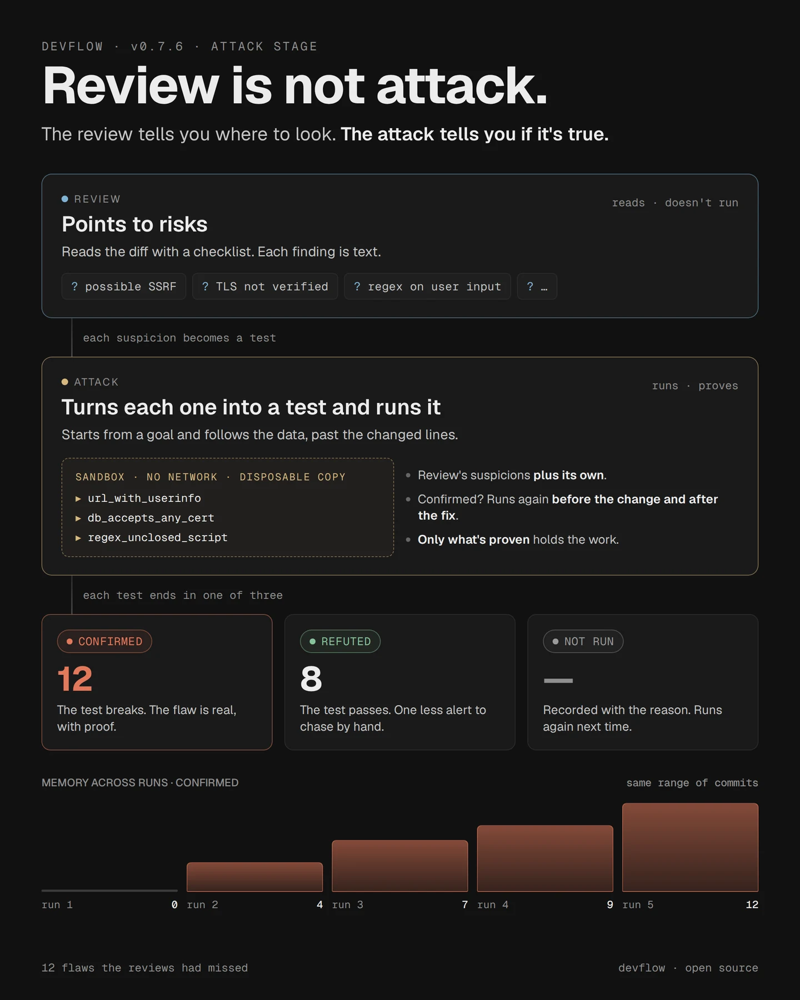

In the [Devflow post](/blog/devpit-devflow) I said I built the review by putting together the best skills I found, including the security ones. Every change went through a security reviewer, it listed the risks and I fixed what made sense. I thought I was covered.

Then I decided to try something else: instead of asking an agent to review, I asked it to attack. Each suspicion had to become a test running in a sandbox with no network. If the test broke, the flaw was real.

I ran this on a real piece of an AI service that was already in production. It confirmed 12 flaws, each with a test as proof. None of them had shown up in the reviews.



## Why the Skills Didn't Catch Them

The security skills are good, and I still use them. But they do one thing: the model reads the change with a checklist in mind and points out what looks wrong. That has three limits I only saw later.

The first is that reading is not running. Almost every flaw depended on how a library actually behaves: a URL with a user embedded in it (`http://someone@host`) that the validation read one way and the parser another, a database connection that accepted any TLS certificate, a regex that hung on an unclosed `<script`. Reading, the model may even get suspicious, but the suspicion turns into one more "consider validating this input". Running, the test breaks or passes.

The second is that the review looks at the diff. The attack starts from a goal, like "make the server fetch a URL I chose", and follows the data through the code. That regex was outside the changed lines: the change only started sending user text to a function that already existed. No review of the diff would get to it.

The third is that a review finding is just text. Writing "possible SSRF" costs the same as writing "nothing found", so the report either comes full of alerts or comes too cautious. In the attack, each suspicion becomes a regular test in the project, and the result is confirmed, refuted or not run, with the reason. On that piece there were 12 confirmed and 8 refuted, and the refuted ones would have been eight alerts for me to investigate by hand.

## Memory Made More Difference Than the Model

The attacker isn't consistent. On the same range of commits, there were runs that confirmed nothing.

What fixed it was keeping what each run tried. A refuted suspicion doesn't come back while its code doesn't change, and one left open runs again on the next run. With that, the confirmed ones kept going up: 0, 4, 7, 9 and 12. A skill starts from zero every time.

## How It Ended Up in devflow

The attack became its own stage, after the review:

```yaml
stages:
  attack:
    run: sensitive   # off | sensitive | per-item | release
```

It takes the review's suspicions, adds its own and runs each test in a container with no network, on a disposable copy of the code. When a flaw is confirmed, the same test runs on the code from before the change and after the fix, to know whether it was this change that opened the problem. Only what was proven holds the work. And in CI, `devflow attack --range` generates SARIF and fails the pipeline when it confirms an attack.

## What Went Wrong Along the Way

Building a tool that attacks code has a side effect: it attacks you too.

The sandbox brought my computer down three times. When a test ran past its time, the code sent a `kill` to the test's process group, and my distribution's version of `kill` read that as "all of the user's processes". The attacker's first victim was me.

Then the reviewer that was supposed to be read-only ran docker on my machine. The option I used to limit its tools only added permissions, it didn't take any away. Today it starts with no terminal at all.

And every time I wrote a filter as a list of what is forbidden, the next review found a new way through. The fix was always the same: flip it into a list of what is allowed.

## Where It Is

It's not magic. A run takes a few minutes, needs docker, a single run may find nothing, and this was an experiment in my day to day, not a study. The review is still the first filter. The attack comes after, to prove what matters.

What changed for me was this: the review tells me where to look, and the attack tells me if it's true.

All of this is in [devflow 0.7.6](https://github.com/jholhewres/devflow/releases/tag/v0.7.6), which works in any agent that speaks MCP: Claude Code, Codex, Cursor, Gemini CLI and devpit.

---

**Links:**

- [devflow on GitHub](https://github.com/jholhewres/devflow)
- [Post: Devflow, From Agent Skills to a Development Flow](/blog/devpit-devflow)
