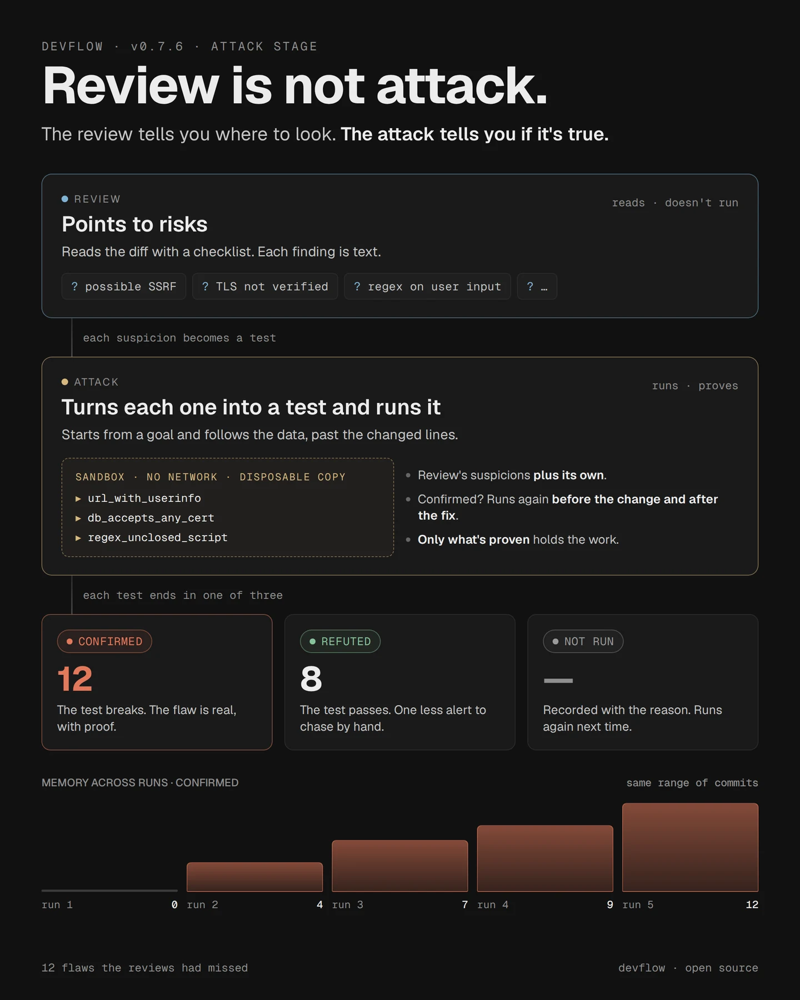

No [post do Devflow](/blog/devpit-devflow) eu contei que montei a revisão juntando as melhores skills que encontrei, inclusive as de segurança. Toda mudança passava por um revisor de segurança, ele listava os riscos e eu corrigia o que fazia sentido. Eu achava que estava coberto.

Aí resolvi testar outra coisa: em vez de pedir pra um agente revisar, pedi pra ele atacar. Cada suspeita precisava virar um teste rodando num sandbox sem rede. Se o teste quebrasse, a falha existia.

Rodei isso num trecho real de um serviço de IA que já estava em produção. Ele confirmou 12 falhas, todas com um teste como prova. Nenhuma tinha aparecido nas revisões.



## Por Que as Skills Não Pegaram

As skills de segurança são boas, e eu continuo usando. Mas elas fazem uma coisa: o modelo lê a mudança com um checklist na cabeça e aponta o que parece errado. Isso tem três limites que eu só vi depois.

O primeiro é que ler não é executar. Quase todas as falhas dependiam de como uma biblioteca se comporta de verdade: uma URL com usuário embutido (`http://alguem@host`) que a validação lia de um jeito e o parser de outro, uma conexão com o banco que aceitava qualquer certificado TLS, uma regex que travava com um `<script` sem fechar. Lendo, o modelo até desconfia, mas a desconfiança vira mais um "considere validar essa entrada". Rodando, o teste quebra ou passa.

O segundo é que a revisão olha o diff. O ataque parte de um objetivo, tipo "fazer o servidor buscar uma URL que eu escolhi", e segue o dado pelo código. Aquela regex estava fora das linhas alteradas: a mudança só passou a mandar texto do usuário pra uma função que já existia. Nenhuma revisão do diff chegaria nela.

O terceiro é que um achado de revisão é só texto. Escrever "possível SSRF" custa o mesmo que escrever "nada encontrado", então o relatório ou vem cheio de alertas ou vem cauteloso demais. No ataque, cada suspeita vira um teste comum do projeto, e o resultado é confirmada, refutada ou não executada, com o motivo. Naquele trecho foram 12 confirmadas e 8 refutadas, e as refutadas seriam oito alertas pra eu investigar na mão.

## A Memória Fez Mais Diferença Que o Modelo

O atacante não é estável. Na mesma faixa de commits, teve rodada que não confirmou nada.

O que resolveu foi guardar o que cada rodada tentou. Uma suspeita refutada não volta enquanto o código dela não muda, e uma que ficou em aberto roda de novo na próxima. Com isso, as confirmadas foram subindo: 0, 4, 7, 9 e 12. Uma skill começa do zero toda vez.

## Como Ficou no devflow

O ataque virou uma etapa própria, depois da revisão:

```yaml
stages:
  attack:
    run: sensitive   # off | sensitive | per-item | release
```

Ele recebe as suspeitas da revisão, soma as dele e roda cada teste num container sem rede, numa cópia descartável do código. Quando uma falha é confirmada, o mesmo teste roda no código de antes da mudança e depois da correção, pra saber se foi essa mudança que abriu o problema. Só o que foi provado segura o trabalho. E no CI, `devflow attack --range` gera SARIF e falha o pipeline quando confirma um ataque.

## O Que Deu Errado no Caminho

Construir uma ferramenta que ataca código tem um efeito colateral: ela também te ataca.

O sandbox derrubou o meu computador três vezes. Quando um teste passava do tempo, o código mandava um `kill` pro grupo de processos do teste, e a versão do `kill` da minha distribuição lia aquilo como "todos os processos do usuário". A primeira vítima do atacante fui eu.

Depois, o revisor que devia ser só leitura rodou docker na minha máquina. A opção que eu usava pra limitar as ferramentas dele só acrescentava permissões, não tirava nenhuma. Hoje ele abre sem terminal nenhum.

E toda vez que eu escrevi um filtro como lista do que é proibido, a revisão seguinte achou um jeito novo de passar. A solução foi sempre a mesma: inverter pra uma lista do que é permitido.

## Onde Ele Está

Não é mágica. Uma rodada leva uns minutos, precisa de docker, uma rodada sozinha pode não achar nada, e isso foi uma experiência no meu dia a dia, não um estudo. A revisão continua sendo o primeiro filtro. O ataque vem depois, pra provar o que importa.

O que mudou pra mim foi isso: a revisão me diz onde olhar, e o ataque me diz se é verdade.

Tudo isso está no [devflow 0.7.6](https://github.com/jholhewres/devflow/releases/tag/v0.7.6), que funciona em qualquer agente que fale MCP: Claude Code, Codex, Cursor, Gemini CLI e o devpit.

---

**Links:**

- [devflow no GitHub](https://github.com/jholhewres/devflow)
- [Post: Devflow, de Skills Para Agentes a um Fluxo de Desenvolvimento](/blog/devpit-devflow)
